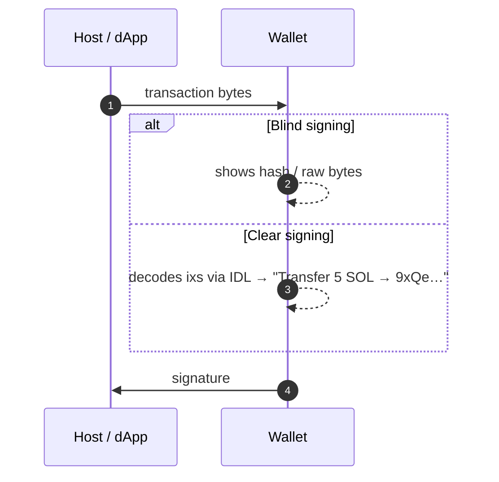
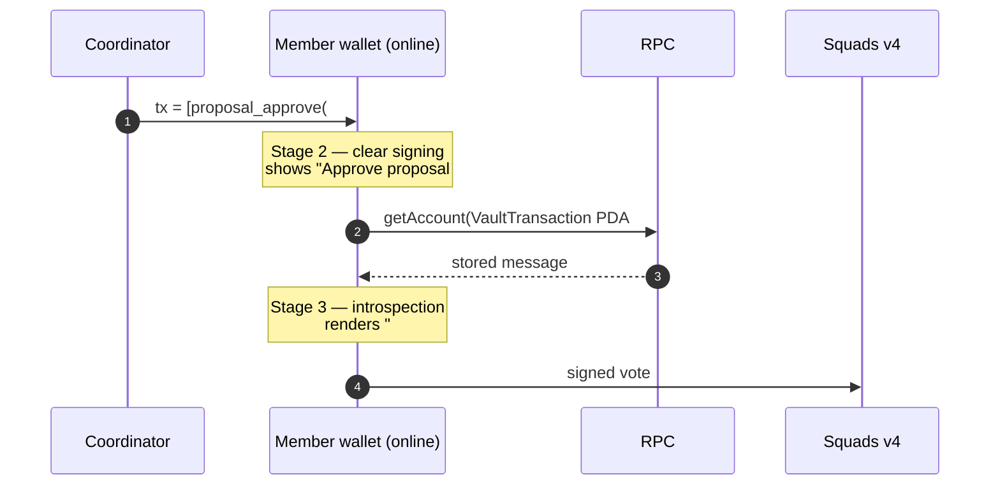
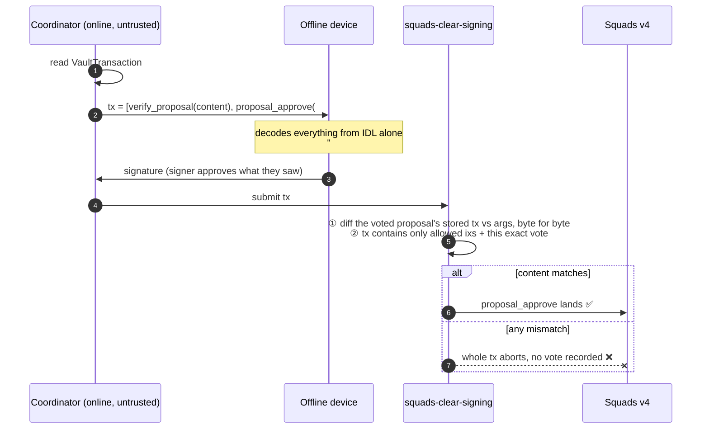
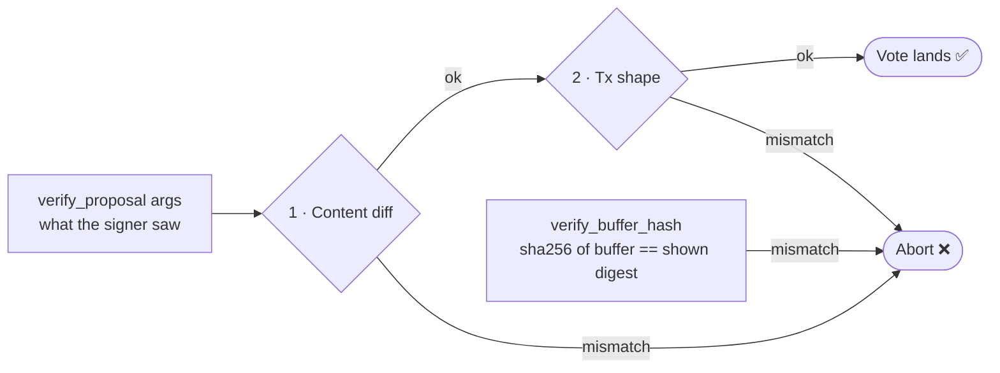

# Squads Clear Signing

A companion program for [Squads Protocol v4](https://github.com/Squads-Protocol/v4) that makes
proposal approvals **clear-signable on offline / air-gapped signing devices**: the signer sees
exactly what a proposal will do, and the chain rejects the vote if what they saw isn't what the
proposal actually does.

Program ID: `7xs3LhQjKoCGfXm2qst7LUhismrG1bGxz5Jw6AHij7eu` *(placeholder — regenerate before any real deployment)*


---

## The problem

When a Squads member approves a proposal, the transaction they sign contains only
`proposal_approve(multisig, member, proposal)` — a vote on a PDA. The *content* being approved
(the `VaultTransaction`) lives on-chain, where an offline device cannot see it. A device that
decodes transactions purely from **IDL + instruction data** can only show *"approve proposal
#42"*, never *what* #42 does. That is blind signing: a compromised coordinator machine can show
the signer one thing while the on-chain proposal does another.

Clear signing alone doesn't fix this for Squads, because the vote *is* fully decoded — it just
doesn't contain anything worth reading. Where the content lives decides how far each signing
setup can get:

| Track | Stage 1 | Stage 2 | Stage 3 |
|---|---|---|---|
| **Online wallet** (normal tx) | Blind: signs opaque bytes | **Clear**: IDL-decoded instructions | not needed — the tx *is* the content |
| **Squads — online** | Blind | Clear, but only *"approve #42"* | **Clear + chain introspection**: wallet reads the proposal over RPC |
| **Squads — offline** | Blind | Clear, no context: *"approve #42 → ???"* | **Clear signing via this program**: content inside the tx, enforced on-chain |

### Online: blind → clear

For an ordinary transaction every instruction is inside the signed payload, so decoding it via
IDL shows the whole truth.



### Squads online: blind → clear → clear + chain introspection



Stage 3 works only because **the wallet itself is online**. It trusts its RPC and its own
rendering, and nothing on-chain ties the vote to what was displayed.

### Squads offline: blind → clear, no context → clear signing via this program

An air-gapped device has no RPC, so it can't introspect. Without this program it is stuck at
stage 2: it can render the vote, but not what the vote approves.


---

## The fix

The wallet prepends instructions from this program to the same transaction as the vote:

```
tx = [ squads_clear_signing::verify_buffer_hash(buffer, sha256-hex),  ← program upgrades only
       squads_clear_signing::assert_*(...)*,                          ← optional state pins (below)
       squads_clear_signing::verify_proposal(expected_content),       ← decodable offline via IDL
       squads_multisig_program::proposal_approve(...) ]
```

`verify_proposal`'s arguments carry the **complete expected content** of the vault transaction —
every inner program id, every account (pubkey + signer/writable flags), and the raw instruction
data, byte for byte. All of it is structured Anchor data, so the offline device renders it from
this program's IDL alone (and can recursively decode inner `data` blobs using the inner programs'
IDLs, since the inner `program_id`s are right there).



### What the chain enforces



1. **Content diff** — deserializes the `VaultTransaction` behind the voted proposal and compares its compiled
   message against `args.instructions`: program ids, account pubkeys, writable/signer flags
   (using Squads' exact header semantics: `[writable signers][ro signers][writable non-signers]
   [ro non-signers]`, then ALT-loaded writables, then ALT-loaded readonlys), and byte-exact data.
   Address-lookup-table keys are resolved through the *actual* table accounts, which must be
   passed as remaining accounts in message order. (Lookup tables are append-only, so an
   index→address mapping validated at approval time cannot change before execution.)

   The transaction is tied to the proposal without any PDA derivation: both accounts must be
   Squads-owned, carry the `Proposal` / `VaultTransaction` discriminators, and record the same
   `(multisig, index)` as each other and as the args. Squads only creates these accounts at their
   canonical addresses, so those stored fields are authoritative (and a `ConfigTransaction`/`Batch`
   at the same index is refused by the discriminator).
2. **Transaction shape** — reads the **instructions sysvar** and requires every top-level
   instruction in the outer transaction to be one of:
   - this program,
   - the Compute Budget program, or
   - a Squads v4 vote instruction whose discriminator matches `args.action` and whose accounts
     are exactly `(args.multisig, args.member as signer, the proposal passed to verify_proposal)`.

   At least one such vote must be present; **anything else aborts**. So if the transaction
   succeeds at all, the only effect it can have had is the exact vote the signer was shown.

Any mismatch → the whole transaction fails → the vote never lands.

### Program upgrades: `verify_buffer_hash`

Program-upgrade proposals are the hard case for clear signing: the vault transaction's inner
instruction is a loader-v3 `Upgrade` that only *references* a BPF buffer account by address. The
offline signer sees the buffer's pubkey but not the code it holds — a compromised coordinator can
point the proposal at a malicious buffer. `verify_proposal` binds the buffer *address*, but not
its *contents*.

`verify_buffer_hash(buffer, expected_hash)` closes that: it reads the buffer account, checks its
loader-v3 owner and `Buffer` state tag, extracts the program bytes, and hashes them with
**SHA-256 via the native `sol_sha256` syscall** over the bytes with trailing zeros trimmed — the
exact convention (and exact digest) of `solana-verify get-buffer-hash`. `expected_hash` is a
**lowercase-hex `String` (64 chars)** — not a raw byte array — so the offline device renders the
*human-readable digest* the signer compares against `solana-verify`, instead of opaque numbers.
On-chain the program hex-decodes it (rejecting wrong length / non-hex) and compares bytes; both the
hash (a few hundred CU) and the hex parse are negligible. Any mismatch aborts.

> Earlier iterations hashed with `brine-ed25519`, which only offers SHA-512 — a valid commitment,
> but **not** the digest `solana-verify` prints (SHA-256). Switching to the native SHA-256 syscall
> makes the displayed hash directly comparable to `solana-verify get-buffer-hash` and is ~1000× cheaper.

`verify_proposal`'s transaction-shape check whitelists this program (and the ComputeBudget program),
so the clear-signing instructions sit in the same transaction as the vote without tripping the
"nothing but the vote" rule.

### Pinning other state: `assert_account_hash` and `assert_program_revision`

`verify_proposal` binds *what the proposal does*; some proposals are only safe given *what other
accounts contain* at vote time. Two standalone assertions let the signer pin that state too. Both
take a 64-char lowercase-hex SHA-256 (`InvalidHashFormat`, 6037, otherwise) and abort on mismatch.

**`assert_account_hash({ account, owner: Option<Pubkey>, expected_hash })`** — any account
(a config, a mint, an oracle, the vault transaction itself):

1. the passed account equals `args.account` (`AssertedAccountMismatch`, 6038);
2. if `owner` is `Some`, the account's owner equals it (`AccountOwnerMismatch`, 6039) — pass it
   whenever the data is only meaningful under a specific program;
3. `sha256(account.data)` over the **raw, untrimmed** data equals `expected_hash`
   (`AccountHashMismatch`, 6040). Unlike program hashes, trailing zeros are significant for
   account state, so nothing is trimmed. Off-chain: `sha256(getAccountInfo(account).data)`.

**`assert_program_revision({ program, expected_hash })`** — the specialization for a deployed
loader-v3 program, whose code lives in a separate ProgramData account:

1. the `program` account equals `args.program` (`ProgramKeyMismatch`, 6041), is owned by the BPF
   upgradeable loader (`InvalidProgramOwner`, 6042), and is in the `Program` state (`NotAProgram`, 6043);
2. the `programdata_address` stored *in* the program account equals the passed `program_data`
   account (`ProgramDataAddressMismatch`, 6044), which is loader-owned (`InvalidProgramDataOwner`,
   6045) and in the `ProgramData` state (`NotAProgramData`, 6046);
3. the ProgramData's program bytes, trailing zeros trimmed, SHA-256 to `expected_hash`
   (`ProgramHashMismatch`, 6047) — byte-identical to `solana-verify get-program-hash <program>`.

The ProgramData metadata (deploy slot, upgrade authority) is excluded, so the digest identifies
the build, not the deployment. Typical use: pin the revision of a program a proposal CPIs into, or
confirm the currently deployed build before approving its upgrade.

Both hash with the `sol_sha256` syscall, which costs about **0.5 CU per byte** (≈112k CU for a
210 KB program). Raise the compute-unit limit for large programs; data beyond ~2.5 MB cannot be
hashed within a 1.4M CU transaction.

### The attack it stops

| Scenario | Before (offline, stage 2) | With this program |
|---|---|---|
| Coordinator shows "upgrade to v2" but #42 points to a malicious buffer | Device shows only *"approve #42"* → signer approves ❌ | Shown hash ≠ on-chain buffer → `BufferHashMismatch` (6033), no vote ✅ |
| Coordinator shows a benign transfer, but #42 drains the vault | Signer approves blindly ❌ | Shown content ≠ stored tx → `DataMismatch` (6020), no vote ✅ |
| Coordinator shows the truth | Signer can't tell it's the truth | Device renders it; the chain confirms it ✅ |

An honest wallet builds the expected content **from the chain**, so validation passes and the
device displays the truth. A dishonest wallet must either show the device data that doesn't match
the chain (tx aborts) or show the truth (signer catches it).

---

## Trust model

- The companion program can only **abort** — it holds no authority, signs nothing, and is never
  in the CPI path of the vote itself. A bug in it can cause false rejections, never a forged
  approval beyond what the signer already signed.
- The offline device's policy must be: **only sign a transaction it can fully decode as
  `[compute budget*, verify_buffer_hash?, assert_account_hash*, assert_program_revision*, verify_proposal, proposal_approve]`** with this
  program's known program ID, and render the args to the user. Everything else is enforced on-chain.
- The sysvar only exposes *top-level* instructions, which is why the shape check forbids unknown
  programs outright: a foreign instruction could otherwise CPI into Squads (with the member's
  signer privilege) invisibly.
- One vote per transaction: two `verify_proposal`s for *different* proposals in one transaction
  mutually fail each other's shape check, by design.

## What's validated vs. not

| Checked | Not checked (by design) |
|---|---|
| Proposal ↔ transaction: owner, discriminator, same `(multisig, index)` | Proposal status / threshold (Squads enforces on vote & execute) |
| `multisig`, `index`, `vault_index`, ephemeral signer count | `creator` (no post-creation authority) |
| Every instruction: program id, accounts, flags, raw data | Semantic meaning of inner data (that's the device's rendering job) |
| ALT addresses resolved via real table accounts | Lookup table liveness (a deactivated table just fails at execution) |
| Outer tx contains only allowed instructions + the exact vote | Votes on `ConfigTransaction`/`Batch` proposals (see limitations) |
| Upgrade buffer SHA-256 (when `verify_buffer_hash` is present) | |
| Raw account data SHA-256 + optional owner (when `assert_account_hash` is present) | |
| Program → ProgramData link + build SHA-256 (when `assert_program_revision` is present) | |

## Status & limitations

- **Validated on devnet** against live Squads v4, otter-verify, and program-metadata — including
  a bundled *upgrade + verify-build + IDL* proposal: both tamper cases abort, and the honest
  approval executes the upgrade, writes the verification record, and creates the canonical IDL.
- **Transaction size** — the args duplicate the whole inner message, so the approval grows with
  the bundle. Legacy/v0 caps at 1232 bytes; larger bundles use **v1 (4 KB) transactions** (see
  [below](#larger-bundles-version-1-4-kb-transactions)). A hash-commitment mode (device hashes
  the rendered payload chunk-by-chunk) could lift the limit further.
- **Vault transactions only** — votes on `ConfigTransaction` and `Batch` proposals are not yet
  supported (the discriminator check will correctly refuse them); a `verify_config_proposal`
  twin covering `ConfigAction`s is the natural extension, and arguably even more important
  (config changes rotate keys/thresholds).
- `proposal_activate` in the same transaction (draft flows) is currently disallowed by the
  strict shape check.
- The Squads v4 layouts are mirrored (verified against the published source) rather than
  imported, to keep the dependency surface minimal. Pin against the deployed program version.

---

# Instructions

## Requirements

- Rust + `cargo-build-sbf` from Agave 3.x or newer (platform-tools ≥ v1.52; the 2.1 toolchain's
  Rust 1.79 can't build the dependency tree). The Anchor CLI is **not** required.
- Node.js + `npm`
- [`surfpool`](https://github.com/txtx/surfpool) for local runs (forks mainnet just-in-time, so the real Squads v4 program is available)
- `jq` (bundle e2e only)
- `program-metadata` CLI (bundle e2e only, to stage the IDL buffer)

### Anchor 1.2 notes

The program uses `anchor-lang = "1.2"` and the clients use the renamed `@anchor-lang/core` (1.2)
package (formerly `@coral-xyz/anchor`). Two migration notes: in 1.x the instructions-sysvar
helpers (`load_instruction_at_checked`, `ID`) moved out of anchor's
`solana_program::sysvar::instructions` re-export into the split `solana-instructions-sysvar`
crate, which the program now depends on directly; and `@anchor-lang/core`'s client is
API-compatible with the old package for this project's usage (`Program`, `AnchorProvider`,
`Wallet`, `BN`, coders).

## Build & test

```bash
cargo test            # unit tests (host) + mainnet VaultTransaction fixture
cargo build-sbf       # deployable .so
npm install           # client dependencies for scripts/
```

## End-to-end: simple transfer proposal

`scripts/e2e.cjs` runs the full flow against a live cluster: creates a Squads v4 multisig,
funds vault 0, creates a vault transaction (0.001 SOL transfer vault → wallet) + proposal, then
submits a **tampered** approval (must fail on-chain with `DataMismatch`, no vote recorded), then
creates a decoy proposal #2 that drains the vault and tries two **substitution** attacks — honest #1
shown but the vote cast on #2 (`VoteProposalMismatch`), and #2's proposal paired with #1's
transaction (`TransactionIndexMismatch`) — and finally submits the **honest** approval (must pass,
bundled with `assert_program_revision` on this program and `assert_account_hash` on the vault
transaction) and executes the vault transaction.

`run-e2e.sh` then runs `scripts/e2e-assert.cjs`: 14 one-instruction cases for
`assert_account_hash` / `assert_program_revision` — the honest paths plus every failure code
(wrong owner, wrong/malformed hash, args/account mismatch, programdata passed as the program, a
non-loader account, another program's programdata), each checked on-chain.

```bash
surfpool start                      # terminal 1: local mainnet fork (real Squads program)
./scripts/run-e2e.sh                # terminal 2: airdrops, deploys if missing, runs e2e
./scripts/run-e2e.sh devnet         # same against devnet (fund keys/e2e-wallet.json first, ~4 SOL)
./scripts/run-e2e.sh <rpc-url>      # any other cluster
```

Environment variables for `scripts/e2e.cjs`:

| Var | Meaning |
|---|---|
| `RPC_URL` | cluster endpoint |
| `WALLET` | keypair path |
| `RESUME_MULTISIG` / `RESUME_TX_INDEX` | re-enter the scenario at an existing multisig after an interruption |

Public devnet RPC rate-limits aggressively; the script paces and retries, and every step is
idempotent-or-skippable on resume.

## End-to-end: super-squads bundle (upgrade + verify + buffer hash)

`scripts/e2e-super.sh` drives the real [`super-squads`](https://github.com/tiago18c/super-squads)
CLI (cloned under `vendor/`, built as-is) to produce a genuine bundled program-authority proposal
— a loader-v3 upgrade plus an otter-verify build record — and then clear-signs the approval with
**both** instructions:

```
tx = [ verify_buffer_hash(buffer, sha256),   verify_proposal(bundle),   proposal_approve ]
```

It deploys a noop v1 program, hands its upgrade authority to a fresh multisig vault, stages a v2
buffer, runs `super-squads propose`, then submits three approvals and asserts on-chain outcomes:

1. **tampered buffer hash** → fails with `BufferHashMismatch` (6033), no vote recorded
2. **tampered expected instruction data** → fails with `DataMismatch` (6020), no vote recorded
3. **honest** → approval lands; `super-squads execute` runs the vault CPIs; the program hash is
   now v2 and the otter-verify PDA exists

```bash
scripts/e2e-super.sh                 # local surfpool (forks mainnet just-in-time)
SKIP_BUILD=1 scripts/e2e-super.sh    # skip the cargo/sbf builds after the first run
NETWORK=devnet DEPLOYER_KEYPAIR=<funded> scripts/e2e-super.sh   # live devnet
```

It needs **no** `solana-verify` binary — `scripts/program-hash.cjs` reproduces the sha256 digest
(matching `solana-verify get-program-hash`/`get-buffer-hash`, which is also what
`verify_buffer_hash` checks) directly from account data or a local `.so`.

## Approving an existing proposal

`scripts/approve-clearsign.cjs` is the reusable piece: it reads the vault transaction from chain,
builds the expected content, prepends `verify_buffer_hash` when a buffer is given, and submits the
clear-signed vote.

| Var | Meaning |
|---|---|
| `RPC_URL` | cluster (default `http://127.0.0.1:8899`) |
| `WALLET` | member keypair path (required) |
| `MULTISIG` | multisig PDA (required) |
| `TX_INDEX` | proposal / transaction index (default `1`) |
| `BUFFER` | *(optional)* loader-v3 buffer to hash-check — prepends `verify_buffer_hash` |
| `SO_FILE` | local `.so` the buffer must match (required with `BUFFER`) |
| `TAMPER` | `none` (default) \| `hash` \| `data` — corrupt one byte and **expect** the on-chain abort with no vote recorded |

```bash
WALLET=<member-keypair.json> MULTISIG=<pda> TX_INDEX=3 \
  BUFFER=<buffer> SO_FILE=<program.so> \
  node scripts/approve-clearsign.cjs
```

Exit `0` means the observed behavior matched the expectation (the honest approval landed, or the
tampered approval failed with no vote); anything else exits `1`.

## Larger bundles: version-1 (4 KB) transactions

Clear signing puts the *entire* expected bundle content inside `verify_proposal`'s args, which
makes the approval transaction grow with the bundle. A legacy/v0 transaction caps at **1232
bytes**; the upgrade+verify bundle already lands at ~1206 bytes, and adding the IDL/metadata
actions pushes it past the limit. Address lookup tables don't help — they compress the *account
list*, not `verify_proposal`'s inline instruction data.

The fix is a **version-1 transaction**, which raises the wire limit to **4096 bytes**
(`V1_TRANSACTION_SIZE_LIMIT`). v1 also folds the compute-unit limit and loaded-accounts-data-size
into the message *config* (no separate ComputeBudget instruction) and drops ALTs. `@solana/web3.js`
1.x is **read-only** for v1 (`MessageV1.serialize()` throws); building and sending a v1 transaction
requires **`@solana/kit`** 8.x.

`scripts/approve-clearsign-v1.cjs` is the kit-based approval: it reads the vault transaction and
builds the instructions with web3.js/anchor, converts them to kit instructions, and assembles a
v1 message (`createTransactionMessage({ version: 1 })` + `setTransactionMessageComputeUnitLimit`
+ `setTransactionMessageLoadedAccountsDataSizeLimit`). `verify_proposal`'s data is hand-encoded
with borsh — Anchor's client coder caps instruction data at a 1000-byte buffer, which a
multi-instruction bundle overruns (the encoding is cross-checked byte-for-byte against Anchor's
coder for small bundles). `scripts/v1-smoke.cjs` is a minimal standalone check that a cluster
accepts v1 at all.

`scripts/e2e-super.sh` stages an IDL buffer with the installed `program-metadata` CLI, proposes the
full **five-instruction** bundle (verify + metadata allocate/write/init + upgrade), and clear-signs
it with the v1 approval — the resulting transaction is ~1.8 KB, over the v0 limit and under the
v1 limit.

> **Surfpool note:** surfpool accepts v1 transactions but (as of 1.5) does **not** honor the v1
> message config's compute-unit limit — it falls back to the `200k × num_instructions` default. With
> the SHA-256 syscall the honest approval now costs well under that default, so it works on surfpool
> too; this only mattered while the buffer hash was a ~640k-CU software SHA-512. Devnet (agave 4.3)
> honors the config either way.

## Wallet integration

```ts
import * as multisig from "@sqds/multisig";

const [txPda] = multisig.getTransactionPda({ multisigPda, index });
const [proposalPda] = multisig.getProposalPda({ multisigPda, transactionIndex: index });
const txAccount = await multisig.accounts.VaultTransaction.fromAccountAddress(conn, txPda);
const msg = txAccount.message;

// Resolve the combined key table exactly like the program does:
// static keys ++ ALT writables (lookup order) ++ ALT readonlys.
const altAccounts = await Promise.all(
  msg.addressTableLookups.map(l => conn.getAddressLookupTable(l.accountKey)));
const loadedWritable = msg.addressTableLookups.flatMap((l, i) =>
  l.writableIndexes.map(x => altAccounts[i].value.state.addresses[x]));
const loadedReadonly = msg.addressTableLookups.flatMap((l, i) =>
  l.readonlyIndexes.map(x => altAccounts[i].value.state.addresses[x]));
const keys = [...msg.accountKeys, ...loadedWritable, ...loadedReadonly];

const isSigner = (i: number) => i < msg.numSigners;
const isWritable = (i: number) =>
  i < msg.accountKeys.length
    ? (i < msg.numWritableSigners ||
       (i >= msg.numSigners && i - msg.numSigners < msg.numWritableNonSigners))
    : i - msg.accountKeys.length < loadedWritable.length;

const expectedInstructions = msg.instructions.map(ix => ({
  programId: keys[ix.programIdIndex],
  accounts: ix.accountIndexes.map(i => ({
    pubkey: keys[i], isSigner: isSigner(i), isWritable: isWritable(i) })),
  data: Buffer.from(ix.data),
}));

const verifyIx = await clearSigningProgram.methods
  .verifyProposal({
    multisig: multisigPda,
    transactionIndex: index,
    vaultIndex: txAccount.vaultIndex,
    numEphemeralSigners: txAccount.ephemeralSignerBumps.length,
    member: memberPubkey,
    action: { approve: {} },
    instructions: expectedInstructions,
  })
  .accounts({ proposal: proposalPda, transaction: txPda, instructionsSysvar: SYSVAR_INSTRUCTIONS_PUBKEY })
  .remainingAccounts(msg.addressTableLookups.map(l =>
    ({ pubkey: l.accountKey, isSigner: false, isWritable: false })))
  .instruction();

const approveIx = multisig.instructions.proposalApprove({ multisigPda, transactionIndex: index, member: memberPubkey });
// tx = [verifyIx, approveIx]  → send to the offline device for signing.
```

For upgrade proposals, prepend `verify_buffer_hash({ buffer, expectedHash })` where
`expectedHash` is the 64-char lowercase hex from `solana-verify get-buffer-hash` (or
`scripts/program-hash.cjs`).

To pin other state, prepend any number of:

```js
await program.methods
  .assertAccountHash({ account, owner /* PublicKey | null */, expectedHash: sha256Hex(info.data) })
  .accounts({ account })
  .instruction();

// programData = the address stored at bytes 4..36 of the program account
await program.methods
  .assertProgramRevision({ program: programId, expectedHash /* solana-verify get-program-hash */ })
  .accounts({ program: programId, programData })
  .instruction();
```

## Repo layout

- `programs/squads-clear-signing/src/lib.rs` — entrypoint, accounts, IDL-visible arg types (`verify_proposal`, `verify_buffer_hash`, `assert_account_hash`, `assert_program_revision`)
- `programs/squads-clear-signing/src/squads.rs` — mirrored Squads v4 layouts (VaultTransaction, Proposal header), discriminators
- `programs/squads-clear-signing/src/validation.rs` — pure validation logic (message diff, ALT resolution, buffer/program/account hashing) + unit tests
- `programs/squads-clear-signing/src/errors.rs` — granular failure codes
- `programs/squads-clear-signing/tests/mainnet_fixture.rs` — decodes a real mainnet VaultTransaction
- `scripts/e2e.cjs` / `run-e2e.sh` — simple system-transfer proposal, tampered vs honest approval
- `scripts/e2e-assert.cjs` — on-chain cases for `assert_account_hash` / `assert_program_revision`
- `scripts/e2e-super.sh` — full super-squads bundle (upgrade + verify + idl) with buffer-hash + v1
- `scripts/approve-clearsign.cjs` — reusable clear-signed approval builder, legacy tx (+ tamper modes)
- `scripts/approve-clearsign-v1.cjs` — kit-based clear-signed approval as a v1 (4 KB) transaction
- `scripts/v1-smoke.cjs` — minimal check that a cluster accepts a v1 transaction
- `scripts/program-hash.cjs` — sha256/sha512 program & buffer hashing without solana-verify
- `docs/img/` — diagrams used in this README
- `vendor/super-squads/` — upstream CLI clone (git-ignored), built as-is for the bundle e2e
