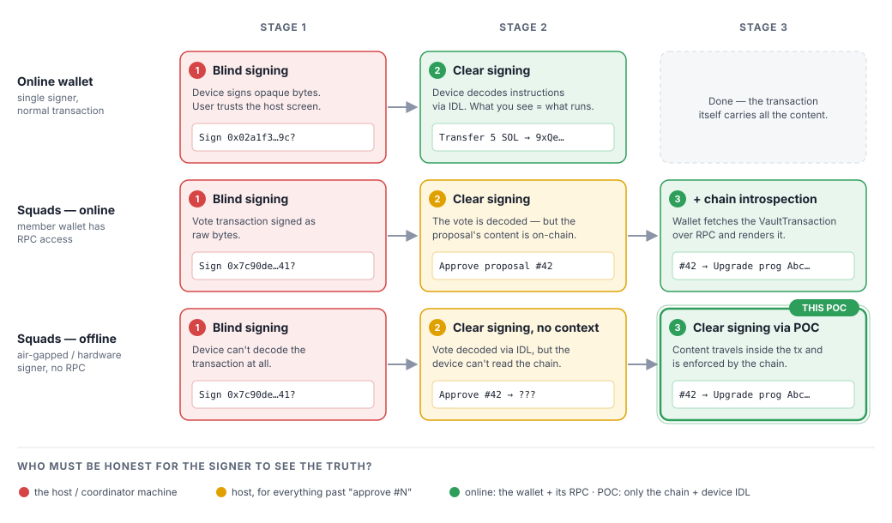
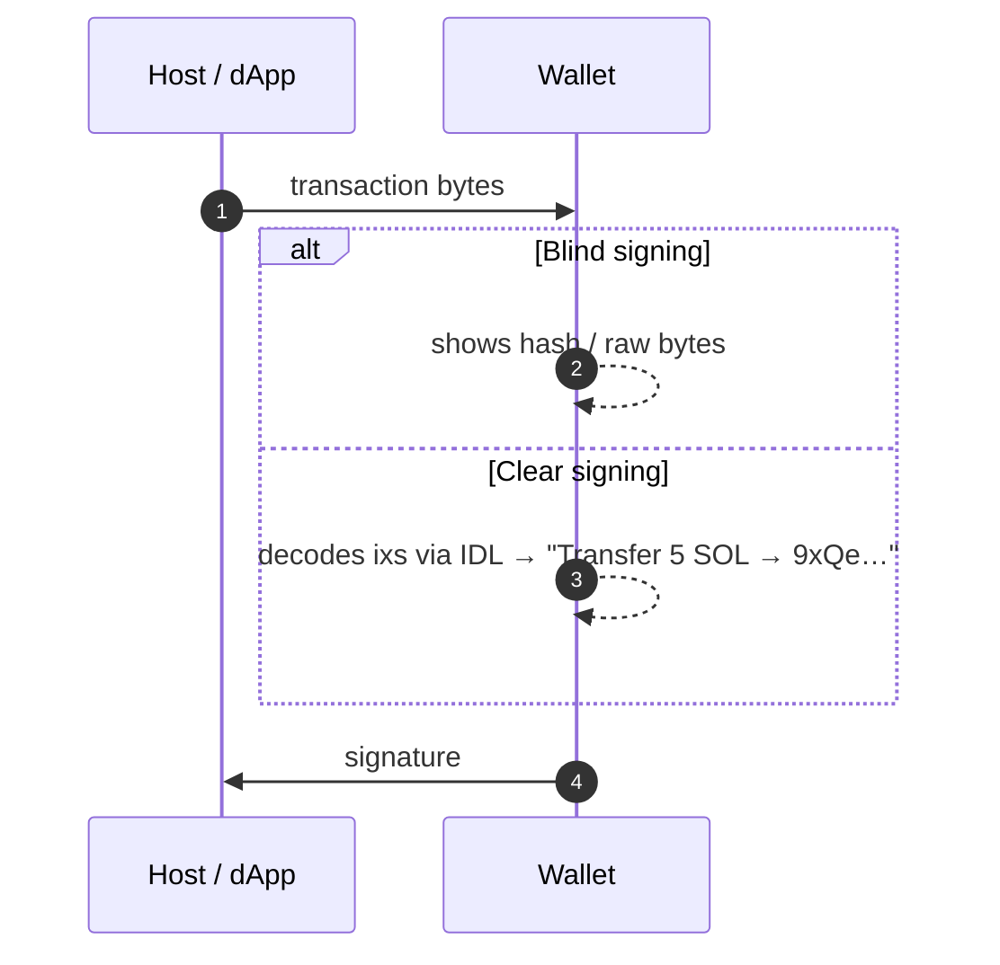
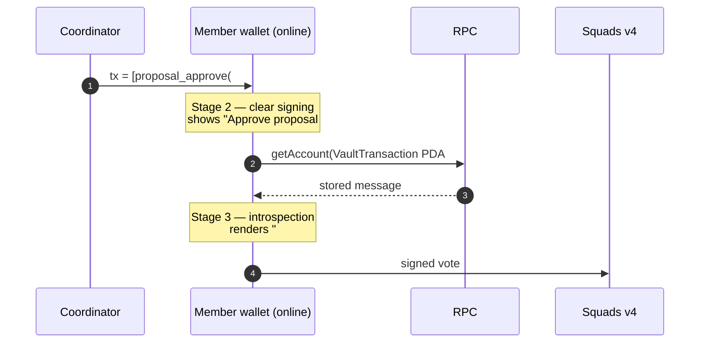
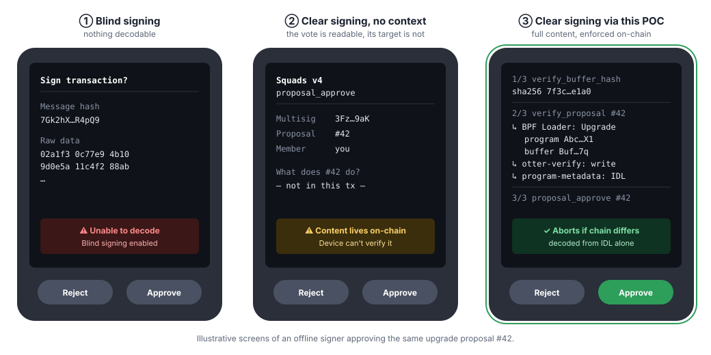
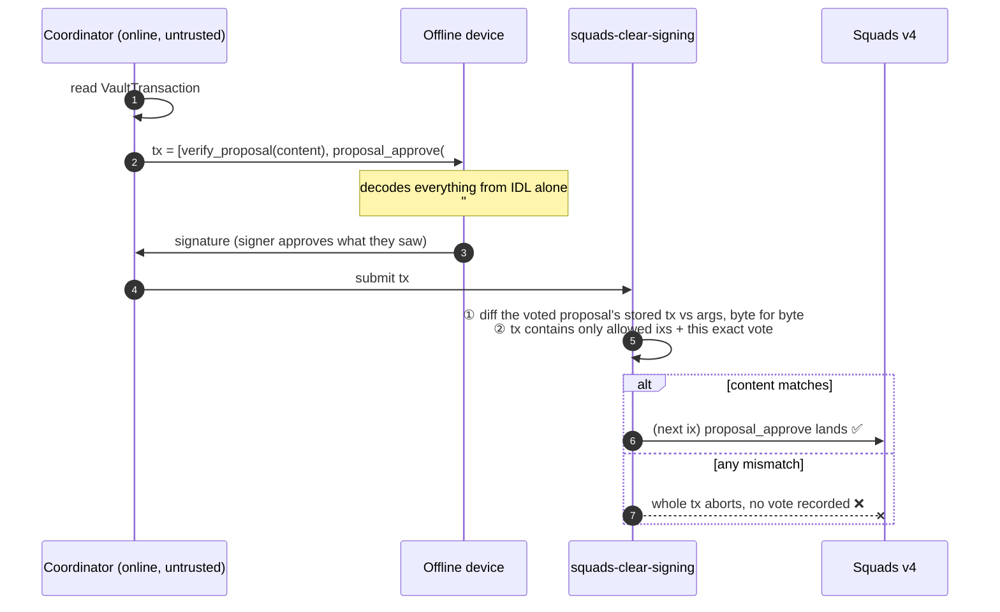
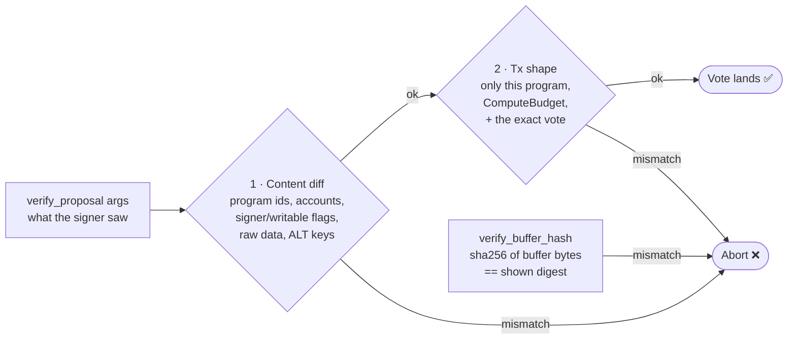

# Squads Clear Signing: what this POC enables

**In one line:** an offline or air-gapped signer can now see exactly what a Squads proposal will do before approving it, and the chain rejects the vote if what the signer saw isn't what the proposal actually does.



---

## 1. The stages at a glance

| Track | Stage 1 | Stage 2 | Stage 3 |
|---|---|---|---|
| **Online wallet** (normal tx) | Blind: signs opaque bytes | **Clear**: IDL-decoded instructions | not needed; the tx *is* the content |
| **Squads, online** | Blind | Clear, but only *"approve #42"* | **Clear + chain introspection**: wallet reads the proposal over RPC |
| **Squads, offline** | Blind | Clear, but no context: *"approve #42 → ???"* | **Clear signing via this POC**: content inside the tx, enforced on-chain |

Why Squads is different: a Squads vote (`proposal_approve`) only references a proposal PDA. The **content** (the `VaultTransaction`) is stored on-chain in a separate account, so decoding the vote alone never tells you what it approves.

---

## 2. Online signing: blind → clear

For an ordinary transaction, clear signing is enough. Every instruction is inside the payload being signed, so decoding it with the program's IDL shows the whole truth.



---

## 3. Squads online: blind → clear → clear + chain introspection



Stage 3 works, but only because **the wallet itself is online**. The wallet has to trust its RPC and its own rendering, and nothing on-chain ties the vote to what was displayed.

---

## 4. Squads offline: blind → clear, no context → clear signing via this POC

An air-gapped device can't run step 3 from the diagram above because it has no RPC. Before this POC, the best it could do was stage 2: *"approve proposal #42"*, with #42's content unknown. A compromised coordinator could show one thing on its own screen while #42 does something else.



### How the POC closes the gap

The coordinator **prepends** instructions from the companion program to the same transaction as the vote. Their arguments carry the complete expected content of the proposal:

```
tx = [ verify_buffer_hash(buffer, sha256-hex)     ← only for program upgrades
       assert_account_hash / assert_program_revision ← optional: pin other state
       verify_proposal(expected instructions)     ← full inner content, IDL-decodable
       proposal_approve(#42) ]                    ← the vote
```



### What the chain enforces



- **Buffer hash** (upgrade proposals): the device displays a SHA-256 digest that is byte-identical to `solana-verify get-buffer-hash`, so the signer can compare the build being deployed against a reviewed or reproducible build.
- **State pins** (optional): `assert_account_hash` pins any account's raw data (and optionally its owner); `assert_program_revision` pins a deployed program's build, following the program account to its ProgramData and matching `solana-verify get-program-hash`.
- **The companion program can only abort.** It holds no authority and isn't in the CPI path of the vote. The worst a bug can do is reject a valid vote. It can't forge one.

---

## 5. The attack it stops

| Scenario | Before (offline, stage 2) | With this POC |
|---|---|---|
| Coordinator shows "upgrade to v2" but #42 points to a malicious buffer | Device shows only *"approve #42"* → signer approves ❌ | Shown hash ≠ on-chain buffer → `BufferHashMismatch` (6033), no vote ✅ |
| Coordinator shows a benign transfer, but #42 drains the vault | Signer approves blindly ❌ | Shown content ≠ stored tx → `DataMismatch` (6020), no vote ✅ |
| Coordinator shows the truth | Signer can't tell it's the truth | Device renders it; the chain confirms it ✅ |

A dishonest coordinator has two options. It can show data that doesn't match the chain, in which case the transaction aborts. Or it can show the truth, in which case the signer sees what the proposal does.

---

## 6. Status and limits

- **Validated on devnet** against live Squads v4, otter-verify and program-metadata. This covers a bundled *upgrade + verify-build + IDL* proposal (both tamper cases abort; the honest approval executes).
- **Size:** content is duplicated into the approval tx. Larger bundles use **v1 (4 KB) transactions** (about 1.8 KB for the 5-instruction bundle). A hash-commitment mode could lift the limit further.
- **Scope:** only `VaultTransaction` proposals. `ConfigTransaction` (key/threshold changes) and `Batch` need a sibling `verify_config_proposal`.
- **Device policy required:** sign only `[compute budget*, verify_*, proposal_approve]` using the known program ID.
